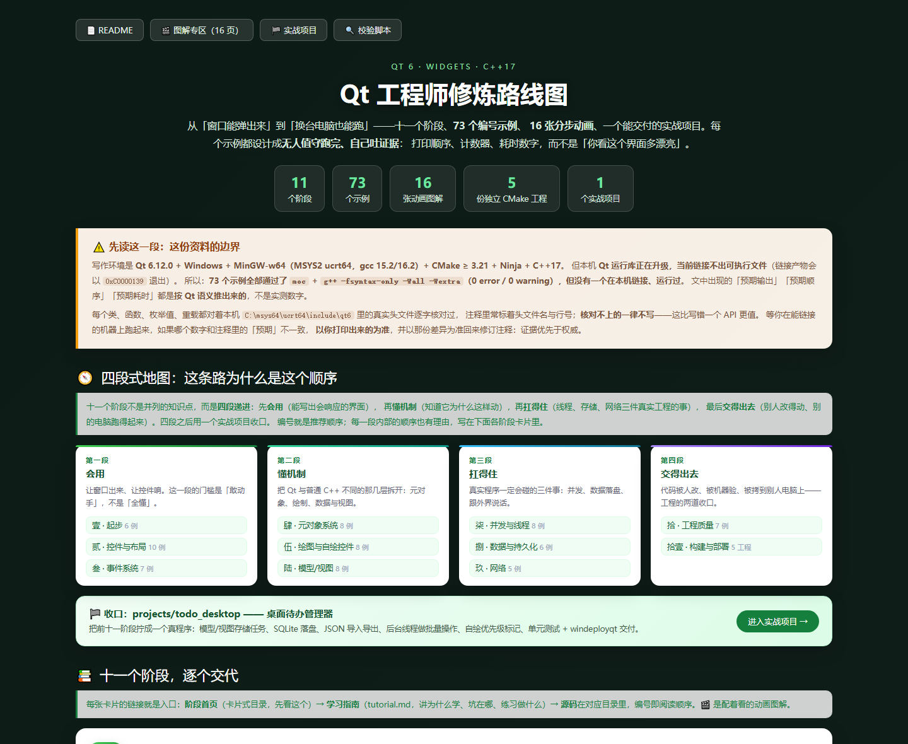
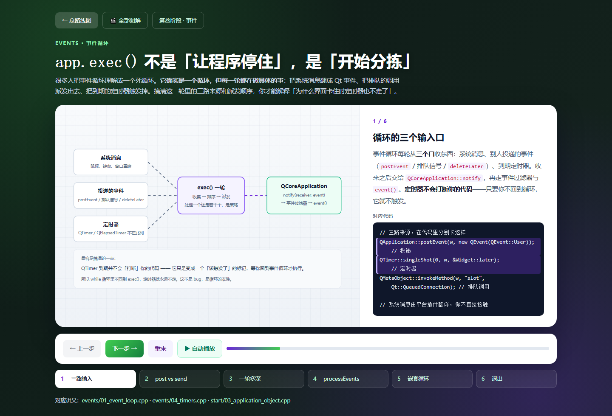

# Qt 从入门到资深 · Qt Learning Path

> 一套面向**零基础到资深**的 Qt 6 系统化学习资料库。
> 从第一个窗口、事件循环、信号槽，到模型/视图、多线程、网络、构建部署，一条路走到一个能交付的桌面程序。




**十一阶段 · 73 个可编译示例 · 16 张分步动画 · 5 份独立 CMake 工程 · 1 个可交付的实战项目**

[总览路线图](学习路线图.html) · [图解专区](visuals/index.html) · [实战项目](projects/todo_desktop/README.md) · [校验脚本](_tools/check_syntax.sh)

---

## 📖 这是什么

这是一条**按顺序走**的 Qt 学习路线，不是零散代码片段的堆砌：

- **十一个阶段**，从「窗口怎么弹出来」到「拷到别人电脑上怎么跑起来」，编号即推荐顺序
- **73 个编号示例**，每个都是**完整可编译**的独立程序（不是伪代码），多数以「取证」为目标：把进入次数、到达顺序、真实耗时打印出来当结论
- **每个阶段两套材料**：`index.html`（卡片式目录，浏览器打开，知道这一阶段学什么、先看哪一篇）+ `tutorial.md`（学习指南，讲**为什么学、坑在哪、练什么**）
- **16 张分步动画图解**：把事件循环、moc、连接类型、布局协商、绘制管线、坐标变换、模型/视图、委托生命周期、线程归属、资源打包、异步网络、质量门、部署树这些「看不见的机制」拆成可翻页的动画，支持自动播放
- **5 份独立 CMake 工程** + 一篇《Qt CMake 实操手册》：构建、资源、测试、翻译、部署各一个最小可运行样例
- **1 个实战项目** `projects/todo_desktop`：把前面十一个阶段拧成一个能用的桌面程序

> 师傅领进门，修行在个人。界面是点出来的，崩溃是查出来的。

---

## 🗺️ 课程地图

| 阶段 | 目录 | 内容 | 示例 | 难度 |
|------|------|------|:----:|:----:|
| 壹 | `start/` | 起步：`main()` → 窗口 → `exec()`、工程结构、日志、无头运行 | 6 | 入门 |
| 贰 | `widgets/` | 控件与布局：常用控件、容器、对话框、`QMainWindow`、尺寸策略、QSS、国际化 | 10 | 进阶 |
| 叁 | `events/` | 事件系统：事件循环、三层派发、过滤器、定时器、输入与焦点、自定义事件、拖放 | 7 | 进阶 |
| 肆 | `metaobject/` | 元对象系统：信号槽、连接类型、moc 解剖、属性、对象树、内省 | 8 | 进阶 |
| 伍 | `painting/` | 绘图：`QPainter`、坐标变换、渐变、字体度量、自绘控件、`QGraphicsView` | 8 | 进阶 |
| 陆 | `model_view/` | 模型/视图：手写模型、编辑回路、委托、代理模型、选择模型、视图调优 | 8 | 中高级 |
| 柒 | `threads/` | 并发与线程：亲和性、跨线程信号、同步、`QtConcurrent`、线程池、收尾、IPC | 8 | 中高级 |
| 捌 | `storage/` | 数据与持久化：`QSettings`、文件 IO、JSON、qrc 资源、SQLite、SQL 模型 | 6 | 中高级 |
| 玖 | `network/` | 网络：`QNetworkAccessManager`、REST、TCP、下载与进度、DNS 与 TLS | 5 | 中高级 |
| 拾 | `quality/` | 工程质量：QtTest、分层架构、所有权审计、错误处理、性能取证、大视图优化 | 7 | 高级 |
| 拾壹 | `build_deploy/` | 构建与部署：CMake 骨架、库分层、资源、CTest、翻译、`windeployqt` | 5 工程 | 高级 |
| 🏁 | `projects/todo_desktop/` | 综合实战：桌面待办管理器 | — | 资深 |

学习顺序**就是编号顺序**，但有两句实话要先说：

- **第肆阶段（元对象）排在控件与事件之后**，是故意的。你在第贰阶段就会写 `connect()`，那时候不懂它是怎么转的没关系；第肆阶段会把 moc、连接类型、对象树一次拆到底。
- **第陆阶段（模型/视图）千万别跳**。它不改变「界面长什么样」，只改变「数据住在哪儿」——而后者才是「会摆界面」和「会做能用的数据界面」的分界。

---

## 📂 目录结构

```
.
├── 学习路线图.html            # ⭐ 总入口，浏览器打开这个（含阶段检验表与构建指引）
├── README.md                  # 你正在读的文件
├── CMakeLists.txt             # 顶层构建：73 个示例 = 73 个 ctest 用例
├── LICENSE
├── .gitignore
│
├── _assets/                   # 共用样式（module.css：所有阶段页统一外观）
├── _tools/                    # check_syntax.sh：moc + 语法校验门（不需要 Qt 运行库）
├── visuals/                   # 图解专区：16 张分步动画 + 首页 hub + 共用 visual.css/visual.js
│
├── start/                     # 第壹阶段 · 起步            （6 例 + index.html + tutorial.md）
├── widgets/                   # 第贰阶段 · 控件与布局      （10 例）
├── events/                    # 第叁阶段 · 事件系统        （7 例）
├── metaobject/                # 第肆阶段 · 元对象系统      （8 例）
├── painting/                  # 第伍阶段 · 绘图与自绘控件  （8 例）
├── model_view/                # 第陆阶段 · 模型/视图与委托 （8 例）
├── threads/                   # 第柒阶段 · 并发与线程      （8 例）
├── storage/                   # 第捌阶段 · 数据与持久化    （6 例）
├── network/                   # 第玖阶段 · 网络            （5 例）
├── quality/                   # 第拾阶段 · 工程质量        （7 例）
├── build_deploy/              # 第拾壹阶段 · 构建与部署    （5 份独立工程 + CMake 手册）
│
└── projects/
    └── todo_desktop/          # 综合实战 · 桌面待办管理器
```

每个阶段目录里都有 `index.html`（卡片目录）与 `tutorial.md`（学习指南）；`build_deploy/` 下的五个子目录各自带 `CMakeLists.txt`，要**单独 configure**，不能由顶层一次性构建。

---

## 🚦 从哪开始

```bash
git clone https://github.com/kurosakimaon/qt-learning-path.git
cd qt-learning-path
```

然后用浏览器打开 `学习路线图.html`（本机双击即可，不需要起服务器）。

1. **浏览器打开 [`学习路线图.html`](学习路线图.html)。** 里面有四段式地图、十一个阶段卡片、每阶段的达标检验表，以及下面的构建命令。所有页面都能离线打开，不依赖网络。
2. **进第壹阶段 [`start/index.html`](start/index.html)。** 先读卡片目录，再按编号读 `01_hello_window.cpp`。每篇顶部注释块都写了「本讲解决什么问题、构建目标叫什么」。
3. **动手改。** 学 Qt 最有效的一步是：把示例改坏一处，看它怎么坏；再改回来。这份资料的注释通常直接告诉你「改这里会看到什么」。

**前置要求**：会一点 C++（类、指针、模板能读懂即可），装好 Qt 6.x（≥ 6.5，资料按 6.12 写）+ CMake ≥ 3.21 + 任一 C++17 编译器。没装 Qt 也能先读——语法门的用法见下面「怎么验证」。

**适合谁**：从「没写过 GUI」到「写过几年 Qt 但说不清 moc 生成什么、事件循环怎么转、为什么跨线程连接会排队」的人。不必从第壹阶段一路读到第拾壹阶段，但**编号顺序是有理由的**，跳读前先看一眼路线图里的四段递进说明。

---

## ✅ 怎么验证

### 一、不装 Qt 也能做的校验（语法门）

```bash
bash _tools/check_syntax.sh            # 全部阶段
bash _tools/check_syntax.sh events     # 只查一阶段
```

这个脚本对每个 `.cpp` 做三件事：需要时跑 `moc`、用 `g++ -fsyntax-only -std=c++17 -Wall -Wextra` 编译（**0 error / 0 warning 才算过**）、检查编号文件有没有入口（`main` 或 `QTEST_*_MAIN`）。它**不链接、不运行**，所以能在一台没有可用 Qt 运行库的机器上判断「代码编不编得过」。

### 二、有 Qt 的机器上：编 + 跑

```bash
cmake -G Ninja -B build -S . -DCMAKE_PREFIX_PATH=C:/msys64/ucrt64
cmake --build build --target start_01_hello_window
ctest --test-dir build -R start_01 --output-on-failure

cmake --build build --target all_demos            # 73 个示例全编
ctest --test-dir build --output-on-failure        # 全部无头跑一遍
```

顶层 `CMakeLists.txt` 把每个示例都注册成 CTest 用例，强制 `QT_QPA_PLATFORM=offscreen`、120 秒超时，所以**不需要显示器、不需要鼠标键盘**。示例自己会在末尾 `quit()`，不会挂着等你点关闭。

常用目标：`all_demos`（全部）、`all_<阶段>`（如 `all_events`）、`<阶段>_<编号>_<名字>`（单个，如 `events_02_event_dispatch`）。

### 三、`build_deploy/` 的五个工程单独构建

```bash
cd build_deploy/qt_cmake_01_widgets
cmake -G Ninja -B build -S . && cmake --build build
./build/qt_cmake_01_widgets
```

### 四、浏览器页面自检（已实测）

页面部分不依赖 Qt，交付前已经在 Chrome 无头模式下逐页、逐步渲染核对过：

- **30 个 HTML 页面**：11 个阶段目录页的卡片数、标题前缀（「第壹阶段」…「第拾壹阶段」）、`<title>` 与 `.header` / `.intro-section` 是否齐全；`visuals/index.html` 的 16 张图卡片；`学习路线图.html` 的 11 个阶段卡、16 张图卡片与「达标检验」「七条铁律」两段
- **16 张图解共 103 步**：用 `#step-N` 深链逐帧打开，核对计数器、步骤标题、讲解文字、SVG 画布、步骤条高亮；控制台不允许出现 `Uncaught` / `SyntaxError` / `ReferenceError` / `TypeError`

也就是说：**页面能打开、每一步都渲染得出来、没有脚本报错**，这一条是实测过的；没实测的是 Qt 程序的运行结果（见下面「资料边界」）。

---

## 🎬 图解专区

[`visuals/index.html`](visuals/index.html) 是 16 张动画的总入口。每页左边一张 SVG、右边讲解与代码，底下是步骤条：支持自动播放、点击跳步、键盘 `←` `→` `Home` `End`。



图负责讲清「东西在哪儿、按什么顺序动」，代码负责对回讲义里的具体文件——两者一起看，比单读任何一边都稳。


---

## 🏁 实战项目

[`projects/todo_desktop/`](projects/todo_desktop/README.md) 是整条路线的收口：一个桌面待办管理器。它不追求功能多，追求**每一处都能指出用的是哪个阶段的知识**：模型/视图存任务、SQLite 落盘、JSON 导入导出、后台线程批量操作、自绘优先级标记、单元测试与部署。

---

## ⚠️ 资料边界（请先读）

这份资料是在 **Qt 6.12 / Windows / MinGW-w64（MSYS2 ucrt64）/ CMake ≥ 3.21 / C++17** 下写的，但写作时本机 **Qt 运行库不可用，链接产物会以 `0xC0000139` 退出**。因此：

- 73 个编号示例**全部通过 `moc` + `g++ -fsyntax-only -Wall -Wextra`（0 error / 0 warning）**，但**没有一个在本机链接、运行过**
- `projects/todo_desktop` 的 13 个头文件、12 个源文件与单元测试同样只过了 `moc` + 语法门，没有 configure / build / run
- `build_deploy/` 的 5 个工程**没有在本机 configure / build / run**，源码同样过了语法门
- 文中出现的「预期输出」「预期顺序」「预期耗时」都是**按 Qt 语义推理**得到的，不是实测数字
- 每个类、函数、枚举值、重载都对着本机 `C:\msys64\ucrt64\include\qt6` 里的真实头文件逐字核对过，注释里常标着头文件名与行号；**核对不上的一律不写**

等你在能链接的机器上跑出真实结果，**以你打印出来的为准**。发现注释与实测不一致的地方，那正是这份资料最值得你回填的位置。

---

## 🔍 遇到问题先看这几处

| 症状 | 先看 |
|------|------|
| `找不到 Qt6` / configure 就失败 | 顶层 `CMakeLists.txt` 里的提示段；`-DCMAKE_PREFIX_PATH` 是否指向 Qt 安装目录 |
| 链接期 `vtable for XXX 未定义` | 该文件是否 `#include "本文件名.moc"`，`CMAKE_AUTOMOC` 是否打开（第肆、第拾壹阶段都有专门讲解） |
| 程序起来就退出 / `no Qt platform plugin` | 平台插件目录；`QT_QPA_PLATFORM=offscreen` 只用于自测，不是交付配置 |
| 界面卡住、定时器不响 | 事件循环是否被槽里的大循环占住（第叁阶段第 1 讲有实证） |
| 表格改完数据不刷新 | 是否 `emit dataChanged`，`beginInsertRows` / `endInsertRows` 顺序对不对（第陆阶段第 3 讲） |
| 「我这儿能跑，他那不行」 | 部署依赖是否收齐（第拾壹阶段 + `deployment_tree.html`） |

---

## 🙋 反馈与勘误

这份资料的价值在「每个数字都能被验证」。如果你跑出和注释里「预期」不一致的结果、发现某个 API 记错了、页面渲染有问题，直接开 issue 即可——你的实测输出就是最好的补丁。特别注意这类情况：不同 Qt 版本/编译器/驱动下行为本身的差异（比如 `QSqlQuery::execBatch` 各家驱动的支持、定时器精度、字体度量），这类差异值得记进讲义而不是当 bug 修。

---

## 📄 许可

MIT，见 [LICENSE](LICENSE)。
